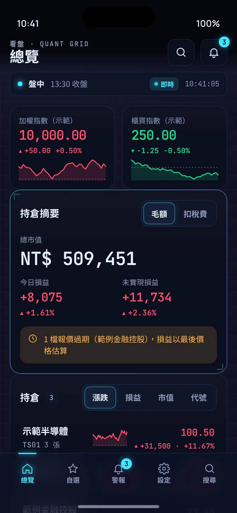
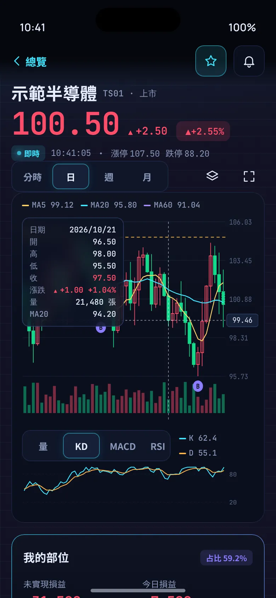
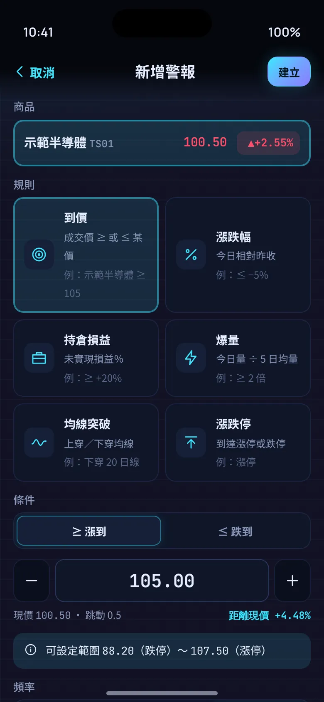
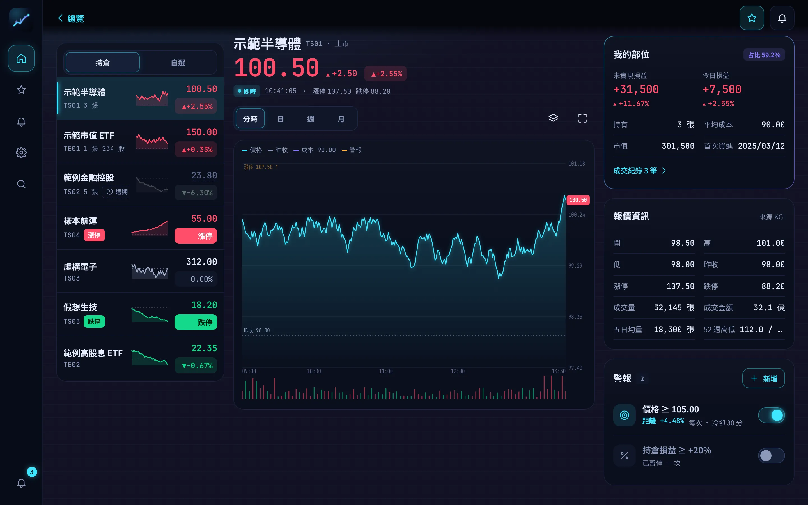

# 看盤 App（Stock Watcher）

iPhone／iPad／桌面的看盤 Web App（iOS 加入主畫面）：持倉、自選、大盤、分時與 K 線、警報推播。**不下單。**

- 設計稿：[`design/DESIGN.md`](design/DESIGN.md)、設計板 `design/mockups.html`
- 規格：[`docs/SPEC.md`](docs/SPEC.md)、[`docs/FRONTEND-CONTRACT.md`](docs/FRONTEND-CONTRACT.md)、[`docs/DESIGN-BRIEF.md`](docs/DESIGN-BRIEF.md)

  

所有畫面中的商品、價格與損益都是虛構範例。
