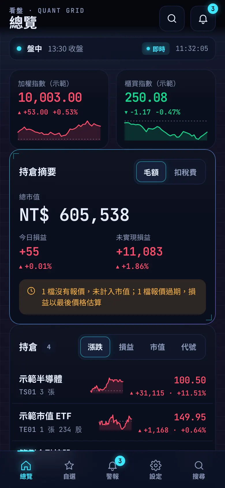
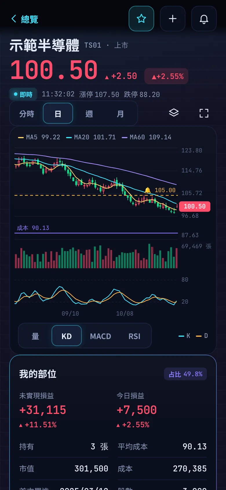
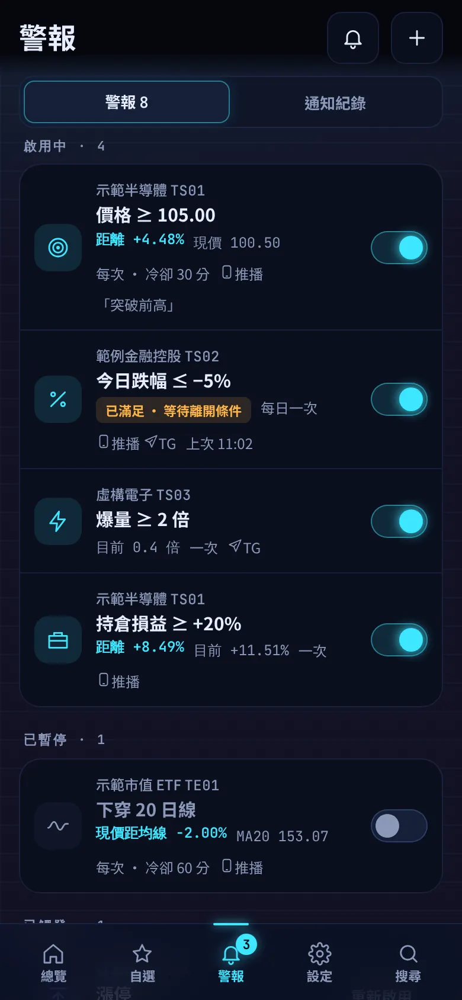
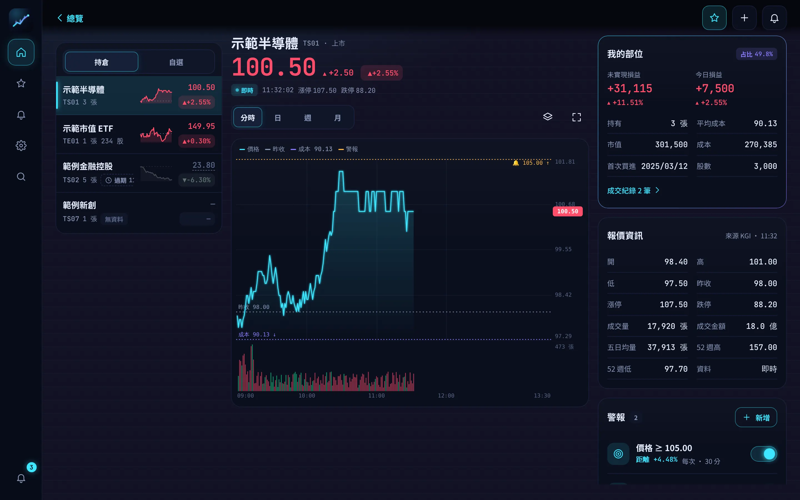

# 看盤 App（Stock Watcher）

iPhone／iPad／桌面的看盤 Web App（iOS「加入主畫面」）：持倉、自選、大盤、分時與日／週／月 K、到價警報推播。**不下單。**
頁面在 `/stocks`，API 在 `/api/watch/*`，依 [`docs/FRONTEND-CONTRACT.md`](docs/FRONTEND-CONTRACT.md) v1.0 開發；目前用 mock 跑，後端完成後直接接上。

> 畫面中的商品、價格與損益都是**虛構範例**（`TS01`～`TS09`、`TE01`、`TE02`），不是真實行情。

<p>
  
  
  
</p>
<p></p>

## 文件

| 文件 | 內容 |
|---|---|
| [`design/DESIGN.md`](design/DESIGN.md) | 設計稿「Quant Grid」：設計系統、畫面、狀態、圖表規格、通知、與記帳 App 的一致與不同 |
| `design/mockups.html` | 設計板（`npx serve design` 後開啟） |
| [`docs/SPEC.md`](docs/SPEC.md) | 功能規格 |
| [`docs/FRONTEND-CONTRACT.md`](docs/FRONTEND-CONTRACT.md) | API 型別與規則（凍結） |
| [`docs/DESIGN-BRIEF.md`](docs/DESIGN-BRIEF.md) | 設計需求 |

## 開發

```bash
npm install
```

```bash
npm run dev
```

開啟 <http://localhost:5173/stocks/>。開發模式在瀏覽器內攔截 `fetch('/api/watch/*')`，不需要後端。

| 指令 | 用途 |
|---|---|
| `npm run dev` | mock 模式 |
| `npm run dev:api` | 不載入 mock，`/api` 轉送到 `.env.api` 的 `VITE_API_TARGET` |
| `npm test` | 單元測試（格式、十進位金額、升降單位、指標、路由、mock 契約涵蓋） |
| `npm run build` | 正式版（不含 mock；CI 會檢查） |
| `npm run build:preview` | 單一 HTML 預覽版 `dist-preview/stocks-preview.html`（含 mock、記憶體路由） |
| `npm run icons` | 由 `design/icon.svg` 產生 PNG 圖示 |

### Mock 情境（契約 §7）

設定頁最下方「開發用 Mock」，或網址參數：

- `?mock=` `slow`（骨架）、`auth`（401 登入過期）、`validation`（下一次寫入 422）、`version`（409）、`rate`（429＋Retry-After）、`down`（行情 503）、`offline`
- `?session=` `open`、`pre_open`、`closing_auction`、`post`、`closed`（休市）
- `?push=` `unsupported`、`not_installed`、`default`、`granted`、`revoked`、`denied`
- `?empty=1`（沒有持倉、自選、警報）、`?extreme=1`（4 位數價格、億元損益）、`?nodevices=1`

固定涵蓋的商品狀態：TS01 即時、TS02 過期、TS03 稍舊（分時自 10:42 起）、TS04 漲停、TS05 跌停、TS06 來源中斷、TS07 無資料（K 線範圍不足）、TS08 暫停交易、TS09 長名稱＋4 位數價格、TE01 分時有缺口。

## 結構

```
design/          設計 tokens、元件、版面 CSS（前端直接 import）＋設計板
src/
  api/           HTTP 核心（信封、錯誤碼、冪等 key、登入過期、退避）與端點
  lib/           格式（十進位字串用 BigInt）、升降單位、技術指標、IndexedDB 快取、推播
  ui/            元件、Canvas 圖表、面板、搜尋、下拉更新、左滑
  views/         總覽、個股／指數、自選、持倉、警報、新增警報、通知紀錄、設定、通知設定
  poll.ts        輪詢（可見才輪詢、依市場時段、429／退避）
mocks/           mock 後端（固定種子隨機漫步的 K 線、分時）
public/sw.js     service worker（App shell 快取、推播、通知點擊）
```

## 已實作的重點

- **價格狀態**：即時／稍舊／過期／收盤／來源中斷／無資料在列表、卡片、標題區、圖表都有不同呈現；過期價格去色加虛線，不會看起來像現價。
- **漲跌不只靠顏色**：一律有 ▲▼／＋－；紅漲綠跌（預設）與綠漲紅跌可切換。
- **圖表**：分時（昨收、漲跌停、量柱、缺口斷線不補線、「分時線自 HH:mm 起」）、K 線（MA5/10/20/60、量能、KD／MACD／RSI、partial 最後一根）、成本線、警報線、B／S 點；長按十字游標、拖曳、滾輪／雙指縮放、雙擊還原、往左到底載入更早資料；長按價位「在此價位設警報」。
- **警報**：6 種規則、3 種頻率與冷卻、預覽「距離現價」與「目前已滿足條件」、沒有推播裝置的提醒、登入過期保留表單草稿、Idempotency-Key。
- **iOS 主畫面 App**：安全區域、App 內返回＋邊緣滑動返回、下拉更新（圖表內不觸發）、橫向圖表全螢幕、輸入框 ≥ 16px、離線唯讀、新版本提示、App 角標未讀數、推播權限 6 種狀態。
